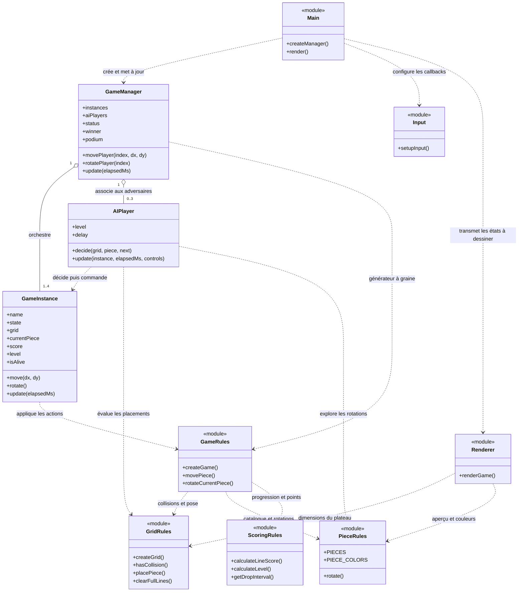
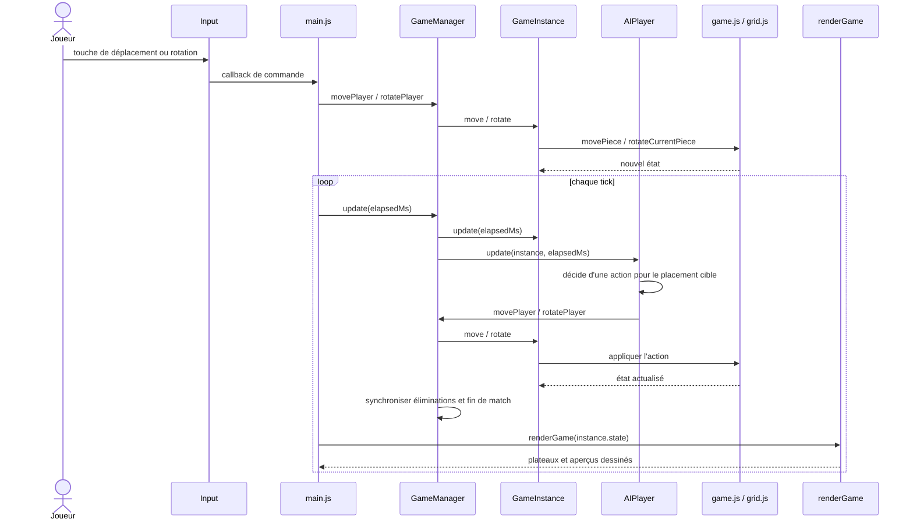

# Architecture

Le cœur (`src/core`) porte les règles de jeu sans dépendre du DOM. L’interface (`src/ui`) dessine les états et traduit les commandes clavier. `main.js` relie les deux couches.

## Diagramme de classes

## Séquence d’un tour de jeu

Le navigateur appelle périodiquement `GameManager.update`. Les parties avancent, les IA décident d’une action à la fois, puis les actions passent par les mêmes méthodes de `GameInstance` que les commandes humaines. L’interface rend ensuite l’état actualisé.

